

  

  

AQUI_VA_EL_GIF

  

---

- 🎓 Estudiante de **Ingeniería de Software** en la Universidad Técnica de Ambato (FISEI)
- 🚀 Apasionada por la tecnología y el emprendimiento
- 💡 Mi meta: crear una empresa tecnológica que impulse a jóvenes emprendedores
- 📱 Creadora de contenido digital

- 🌊 Nací en **Guayaquil**, la Perla del Pacífico
- 🌸 Vivo en **Ambato**, la tierra de las flores y de las frutas
-  Orgullosamente **ecuatoriana**

- 🔭 Trabajando en un catálogo de cursos con agente de IA para el CTT-FISEI
- 🌱 Aprendiendo francés y nuevas tecnologías web
- 🤝 Abierta a colaborar en proyectos de tecnología y emprendimiento
- ⚡ Dato curioso: también creo contenido para redes sociales

---

<h2>💜 Mis Proyectos</h2>

 

  <a href="https://github.com/Leidy0001/Ape4-Grafos"></a>
  <a href="https://github.com/Leidy0001/APE_Arboles"></a>
  <a href="https://github.com/Leidy0001/arbol-bst-empresa-cpp"></a>
  <a href="https://github.com/Leidy0001/Prueba_Practica_Arboles_cpp"></a>
  <a href="https://github.com/Leidy0001/Recorridos-de-rboles-Binarios_Tarea2.2"></a>
  <a href="https://github.com/Leidy0001/registro-calificaciones-cpp"></a>
  <a href="https://github.com/Leidy0001/Registro-de-calificaciones-de-estudiantes"></a>
  <a href="https://github.com/Leidy0001/ComputacionVisual"></a>
  <a href="https://github.com/Leidy0001/comandos_basicos"></a>

  

<h2>🤝 Proyectos en los que he colaborado</h2>

 

  <a href="https://github.com/Sandra-0014/SIHA"></a>
  <a href="https://github.com/DannyDev18/Hakathon_Grok"></a>
  <a href="https://github.com/ReaperMag/Catalogo-Peliculas"></a>
  <a href="https://github.com/ReaperMag/Transporte-Interprovincial"></a>
  <a href="https://github.com/PedroPapus/pedropapus_cleaniq"></a>
  <a href="https://github.com/martin-cnr/Formulario"></a>

---

  

<h3 align="center">💻 Lenguajes</h3>

  

<h3 align="center">🎨 Frontend</h3>

  

<h3 align="center">⚙️ Backend y Frameworks</h3>

  

<h3 align="center">🗄️ Bases de datos y datos</h3>

  
    
  
  

<h3 align="center">🛠️ Herramientas</h3>

  

<h3 align="center">🔌 Plugins y extensiones</h3>

  
  
  
  
  

---

  

  

  

---

  

  
  
  

  

  

